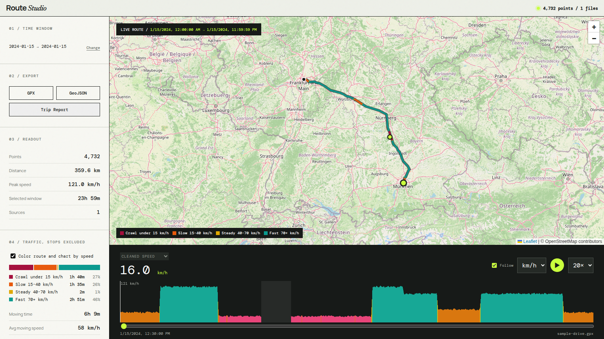

# Car Camera Route Studio

Local, dependency-light route viewer for dashcam TXT, GPX, and GeoJSON files.



## Features

- Date and time range filtering
- Leaflet map with start/end markers
- Route replay with inactive gaps compressed
- Cleaned, raw, and calculated speed views
- Heading, altitude, and sensor charts
- GPX and GeoJSON exports
- Incremental imports for growing dashcam TXT files

## Run

Requires Node.js 22.6+.

```bash
pnpm start
```

Open <http://127.0.0.1:4173>.

## Add data

Place `.txt`, `.gpx`, `.geojson`, or `.json` files in `data/input/`, then run:

```bash
pnpm import
```

Use `pnpm import -- --force` to rebuild the generated cache.

Cleaned speed defaults to a 130 km/h plausibility ceiling. Set `MAX_SPEED_KMH` when importing to change it.

See [docs/formats.md](docs/formats.md) for supported fields and extension guidance.

Preview screenshots and videos can be added to `assets/images/` and `assets/videos/`.

## License

Licensed under [GNU AGPL-3.0-only](LICENSE). Commercial use is allowed. Modified versions offered to users, including over a network, must keep the license notices and make corresponding source code available under the AGPL.
